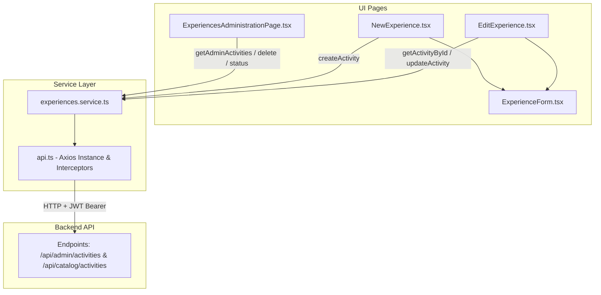

# Requirements

### Overview & Goals
Conectar la interfaz de administración de experiencias (`ExperiencesAdministrationPage.tsx`) y las páginas de creación y edición ubicadas en `../../src/forms/experiences` con los servicios API del backend en SIZZ.

Actualmente, la página pública `ExperiencesPage.tsx` ya se encuentra conectada al endpoint público a través de `portalService.getActivities()` (`GET /portal/activities`). El objetivo es crear la capa de servicio administrativo y migrar las pantallas de gestión interna que aún consumen datos estáticos simulados (`MOCK_EXPERIENCES`) a un flujo asíncrono real con peticiones HTTP autenticadas (JWT).

### Scope
#### In Scope
- **Capa de Servicios**: Creación de `src/services/experiences.service.ts` para interactuar con los endpoints administrativos de experiencias (`GET`, `POST`, `PUT`, `DELETE`, `PATCH`).
- **Mapeo de Datos**: Adaptación bidireccional entre los modelos del backend (ej. topics `FISICA`, `ASTRONOMIA`, precios, aforo, estado) y las estructuras utilizadas por los componentes UI (`AdminExperience`, `ExperienceFormValues`).
- **Listado y Resumen (`ExperiencesAdministrationPage.tsx`)**: Carga de datos reales desde el backend, cálculo dinámico de métricas (Total, Publicadas, Borrador, Requiere revisión), filtros interactivos y estados de carga/error.
- **Creación (`NewExperience.tsx`)**: Envío de nuevas experiencias al backend mediante `POST` con validación y manejo de respuestas.
- **Edición y Consulta (`EditExperience.tsx`)**: Obtención de una experiencia específica por ID desde el backend mediante `GET /admin/activities/:id` y guardado mediante `PUT /admin/activities/:id`.
- **Acciones Rápidas del Catálogo**: Conexión de acciones en tarjeta (cambio de estado entre borrador/publicada, eliminación y edición).

#### Out of Scope
- Modificación del diseño visual base (se conservarán las clases y estilos CSS de `ExperiencesAdministrationPage.css` y `ExperienceForm.css`).
- Cambios en el flujo de reservaciones de taquilla (`/taquilla`).

### User Stories
- **Como administrador**, quiero ver el listado actualizado de experiencias del museo con sus estadísticas reales para conocer el estado operativo del catálogo.
- **Como administrador**, quiero crear una nueva experiencia desde el formulario para que quede registrada en la base de datos del sistema.
- **Como administrador**, quiero consultar y editar los datos de una experiencia existente para mantener actualizada la información de aforo, público, duración y contenido.
- **Como administrador**, quiero cambiar el estado de una experiencia (publicada/borrador) o eliminarla directamente desde el catálogo.

### Functional Requirements
1. **Carga y Visualización**:
   - `ExperiencesAdministrationPage` debe realizar una petición asíncrona al montar el componente.
   - Mostrar indicadores de carga (`Loading / Skeleton`) y estados de error con opción a reintentar.
   - Las tarjetas de resumen deben computar sus valores a partir de los datos recibidos del servidor.
2. **Filtros y Búsqueda**:
   - Búsqueda en tiempo real por texto (nombre de experiencia y categoría).
   - Filtros por categoría (`topic`), público objetivo (`audiences`) y estado (`status`).
   - Toggle funcional entre vista en cuadrícula (`grid`) y lista (`list`).
3. **Flujo de Creación (`NewExperience`)**:
   - Envío de formulario validado.
   - Deshabilitar botón de envío durante la petición (`saving`).
   - Redirección a `/app/experiences` tras la creación exitosa.
4. **Flujo de Edición (`EditExperience`)**:
   - Carga inicial de datos por `id` (manejando IDs alfanuméricos/UUIDs).
   - Manejo de experiencia inexistente (404) mostrando pantalla amigable de no encontrada.
   - Envío de cambios y actualización en backend.
5. **Acciones de Menú en Tarjetas**:
   - Conectar "Pasar a borrador" / "Publicar" ejecutando actualización en backend.
   - Conectar "Eliminar" con confirmación previa.
   - Navegación al formulario de edición al hacer clic en "Editar" o "Ver detalle".

### Non-Functional Requirements
- **Autenticación**: Todas las peticiones administrativas deben enviar el encabezado `Authorization: Bearer <token>` mediante la instancia configurada en `src/services/api.ts`.
- **Resiliencia**: Manejo robusto de expiración y rotación de tokens (gestionado por los interceptores existentes en `api.ts`).
- **Rendimiento**: Evitar recargas completas innecesarias actualizando el estado local de forma optimista o revalidando tras mutaciones.

# Technical Design

### Current Implementation
- `src/pages/public/ExperiencesPage.tsx` está conectado al backend a través de `portalService.getActivities()` (`/portal/activities`), consumiendo el tipo `PublicActivity`.
- `src/pages/app/ExperiencesAdministrationPage.tsx` utiliza una constante en memoria `MOCK_EXPERIENCES` importada desde `../../src/forms/experiences`.
- `../../src/forms/experiences` y `EditExperience.tsx` contienen placeholders `// TODO:` para conectar las llamadas al servicio administrativo.
- `src/services/api.ts` provee la instancia central de Axios con interceptores de autenticación y refresco automático de tokens.

### Key Decisions
1. **Capa de Servicio Dedicada (`experiences.service.ts`)**:
   - *Decisión*: Crear `src/services/experiences.service.ts` (o extender `adminService`) para centralizar las llamadas al backend de actividades/experiencias.
   - *Razón*: Mantener coherencia con la estructura de `portal.service.ts`, `auth.service.ts` y `catalog.service.ts`.
2. **Unificación de Modelos y Adaptadores**:
   - *Decisión*: Implementar funciones de transformación (`toAdminExperience`, `toExperiencePayload`, `toFormValues`) para normalizar los valores entre la API (ej. topics en mayúsculas `FISICA`, IDs alfanuméricos) y la interfaz gráfica.
   - *Razón*: Desacoplar los componentes visuales de los detalles de serialización del backend y mantener compatibilidad con `CATEGORY_THEMES`.
3. **Manejo de Identificadores UUID / String**:
   - *Decisión*: Actualizar el tipo de `AdminExperience.id` de `number` a `string | number` (o `string`) para dar soporte a los identificadores del backend.

### Proposed Changes

#### 1. Nuevo Servicio: `src/services/experiences.service.ts`
Creación del servicio administrativo con las siguientes funciones:
- `getAdminActivities(): Promise<AdminExperience[]>`
- `getActivityById(id: string): Promise<AdminExperience>`
- `createActivity(payload: CreateActivityDto): Promise<AdminExperience>`
- `updateActivity(id: string, payload: UpdateActivityDto): Promise<AdminExperience>`
- `deleteActivity(id: string): Promise<void>`
- `updateActivityStatus(id: string, status: ExperienceStatus): Promise<AdminExperience>`

#### 2. Actualización de Tipos: `../../src/forms/experiences`
- Actualizar `AdminExperience` para permitir `id: string`.
- Mantener las constantes de ayuda (`AUDIENCES`, `LOCATIONS`, `EXPERIENCE_ROUTES`).
- Mantener `MOCK_EXPERIENCES` como fallback para pruebas de desarrollo si es necesario.

#### 3. Actualización de `ExperiencesAdministrationPage.tsx`
- Sustituir el `useState(MOCK_EXPERIENCES)` por carga remota con `useEffect`.
- Añadir estados `loading` y `error`.
- Implementar los handlers para las acciones del menú de tarjeta (`onToggleStatus`, `onDelete`).

#### 4. Actualización de `NewExperience.tsx` y `EditExperience.tsx`
- En `NewExperience.tsx`: invocar `experiencesService.createActivity(values)` y navegar a la lista tras éxito.
- En `EditExperience.tsx`: cargar la experiencia con `experiencesService.getActivityById(id)` usando `useEffect`, mostrar pantalla de carga o error, e invocar `experiencesService.updateActivity(id, values)` en el submit.

### Data Models / Contracts

```typescript
// src/services/experiences.service.ts
import type { CategoryKey } from "../pages/public/ExperiencesPage";
import type { ExperienceStatus } from "../pages/experiences/experience.data";

export interface ApiActivityDto {
  id: string;
  name: string;
  description: string;
  durationMinutes: number;
  capacity?: number;
  location?: string;
  minAge?: number | null;
  maxAge?: number | null;
  topic: string; // ej. "FISICA", "ASTRONOMIA", etc.
  audiences?: string[];
  status?: string; // ej. "PUBLISHED", "DRAFT", "REVIEW"
  price?: number;
  orderIndex?: number | null;
  tagLabel?: string;
  showInCatalog?: boolean;
  availableForBooking?: boolean;
  updatedAt?: string;
  updatedBy?: string;
}

export interface CreateActivityPayload {
  name: string;
  description: string;
  topic: string;
  audiences: string[];
  durationMinutes: number;
  capacity: number;
  location: string;
  status: string;
  orderIndex?: number | null;
  tagLabel?: string;
  showInCatalog: boolean;
  availableForBooking: boolean;
}
```

### Architecture Diagram



### Risks & Mitigations
- **Divergencia en Nomenclatura de Topics / Estados**: El backend puede usar mayúsculas (`FISICA`, `PUBLISHED`) mientras la UI usa minúsculas (`fisica`, `publicada`).
  *Mitigación*: Implementar funciones de normalización y mapeo en el servicio.
- **IDs no numéricos**: El frontend original usaba `id: number`.
  *Mitigación*: Actualizar todas las referencias de `id` para usar `string` de forma uniforme.
- **Manejo de Errores de Red**: Pérdida de conexión o 401 durante el formulario.
  *Mitigación*: `api.ts` gestiona la renovación de tokens; los componentes mostrarán mensajes de error claros sin perder los datos ya capturados en el formulario.

# Testing

### Validation Approach
La validación se realizará verificando la integración de extremo a extremo entre los componentes de React, el servicio de API y el estado de la aplicación.

### Key Scenarios
1. **Listado de Experiencias**:
   - Abrir `/app/experiences` y verificar que se realiza la petición `GET` al backend.
   - Comprobar que las tarjetas se renderizan con los datos devueltos (nombre, duración, aforo, precio, estado).
   - Comprobar que las 4 tarjetas de estadísticas computan correctamente los totales y porcentajes.
2. **Filtrado y Búsqueda**:
   - Escribir en el campo de búsqueda y verificar que se filtran los resultados.
   - Cambiar los selectores de Categoría, Público y Estado y verificar el filtrado reactivo.
   - Conmutar entre vista de cuadrícula y lista.
3. **Creación de Nueva Experiencia**:
   - Navegar a `/app/experiences/new`.
   - Llenar los campos requeridos en `ExperienceForm`.
   - Enviar el formulario y verificar la llamada `POST` al API.
   - Confirmar redirección automática al catálogo con la nueva experiencia visible.
4. **Edición de Experiencia Existente**:
   - Hacer clic en "Editar" en una tarjeta del catálogo.
   - Verificar la carga de datos de la experiencia mediante `GET /admin/activities/:id`.
   - Modificar campos (ej. duración o descripción) y guardar cambios (`PUT`).
   - Verificar la persistencia y redirección.
5. **Acciones de Menú en Tarjetas**:
   - Probar el cambio de estado (pasar a borrador / publicar) y verificar la actualización visual inmediata.
   - Probar la opción de eliminación y verificar que se remueve la tarjeta del listado.

### Regressions & Edge Cases
- **Experiencia no encontrada (404)**: Navegar a `/app/experiences/id-inexistente/edit` y comprobar que se muestra la vista `exf-not-found` sin romper la aplicación.
- **Respuesta vacía del catálogo**: Verificar que se muestra el mensaje de catálogo vacío (`adm-empty`).
- **Filtro sin coincidencias**: Verificar mensaje informativo cuando ningún registro cumple los criterios.
- **Token expirado**: Verificar que el interceptor de `api.ts` renueva la sesión transparentemente sin perder la operación en curso.

# Delivery Steps

###   Step 1: Crear el servicio de API y contratos de datos para experiencias
Establecer el cliente de servicio para operaciones CRUD de experiencias conectando con Axios (`src/services/api.ts`).

- Crear o ampliar `src/services/experiences.service.ts` (o `adminService`) tipando los contratos de petición y respuesta (`AdminActivityResponse`, `CreateActivityDto`, `UpdateActivityDto`).
- Implementar funciones para `getAdminActivities()`, `getActivityById(id)`, `createActivity(payload)`, `updateActivity(id, payload)`, `deleteActivity(id)` y `updateActivityStatus(id, status)`.
- Implementar adaptadores/mapeadores bidireccionales entre el modelo del backend (tópicos en mayúsculas `FISICA`, IDs alfanuméricos/UUIDs, fechas ISO) y los tipos de interfaz de usuario (`AdminExperience`, `ExperienceFormValues`).
- Actualizar `../../src/forms/experiences` para sincronizar los tipos con el servicio y permitir IDs de tipo `string`.

###   Step 2: Integrar ExperiencesAdministrationPage con el API y gestión de estados
La página principal de administración carga datos reales desde el backend y refleja métricas y filtros dinámicamente.

- Reemplazar el estado inicial estático de `MOCK_EXPERIENCES` por una llamada a `experiencesService.getAdminActivities()` en un `useEffect`.
- Añadir estados de carga (`loading`), error (`error`) y botón/mecanismo de reintento en `ExperiencesAdministrationPage.tsx`.
- Conectar el cálculo dinámico de estadísticas (`total`, `published`, `draft`, `review`) a partir de la lista obtenida del API.
- Mantener y ajustar los filtros por texto de búsqueda, categoría, público y estado, así como el toggle entre vista de cuadrícula y lista.

###   Step 3: Conectar la creación de experiencias en NewExperience
El formulario de alta envía la nueva experiencia al backend y redirige al listado tras una creación exitosa.

- Actualizar `../../src/forms/experiences` para invocar `experiencesService.createActivity(values)` en `handleSubmit`.
- Añadir control de estado de guardado/carga y captura de errores con mensajes para el usuario en caso de fallo de red o validación del servidor.
- Asegurar que `ExperienceForm.tsx` bloquee envíos duplicados durante la llamada asíncrona y propague las notificaciones de error apropiadamente.
- Redirigir a `/app/experiences` al completar la creación.

###   Step 4: Conectar la consulta y edición en EditExperience
La página de edición carga los datos de la experiencia específica por su ID desde el backend y persiste los cambios.

- Modificar `../../src/forms/experiences` para obtener los datos de la experiencia vía `experiencesService.getActivityById(id)` usando el parámetro de ruta.
- Implementar estados visuales de carga inicial (`loading`) y pantalla de 'No encontrada' (`exf-not-found`) en caso de error 404.
- Mapear la respuesta del API al formato `ExperienceFormValues` e inyectar `initialValues` y `lastModified` en `ExperienceForm`.
- Implementar la persistencia de cambios mediante `experiencesService.updateActivity(id, values)` y redirección a `/app/experiences` con feedback de éxito.

###   Step 5: Integrar acciones rápidas de catálogo y sincronización
El menú de opciones de cada tarjeta permite ejecutar operaciones de ciclo de vida en el backend y actualizar la vista en tiempo real.

- Implementar los manejadores en `ExperiencesAdministrationPage.tsx` para:
  - Cambiar estado entre publicada y borrador (`updateActivityStatus`).
  - Eliminar experiencia con confirmación de usuario (`deleteActivity`).
  - Navegación al detalle/edición (`onEdit`).
- Actualizar el estado local de la lista tras acciones exitosas para evitar recargas completas innecesarias o refrescar la lista desde el servidor.
- Validar la consistencia entre las experiencias administradas y las actividades visibles en `ExperiencesPage.tsx` pública.